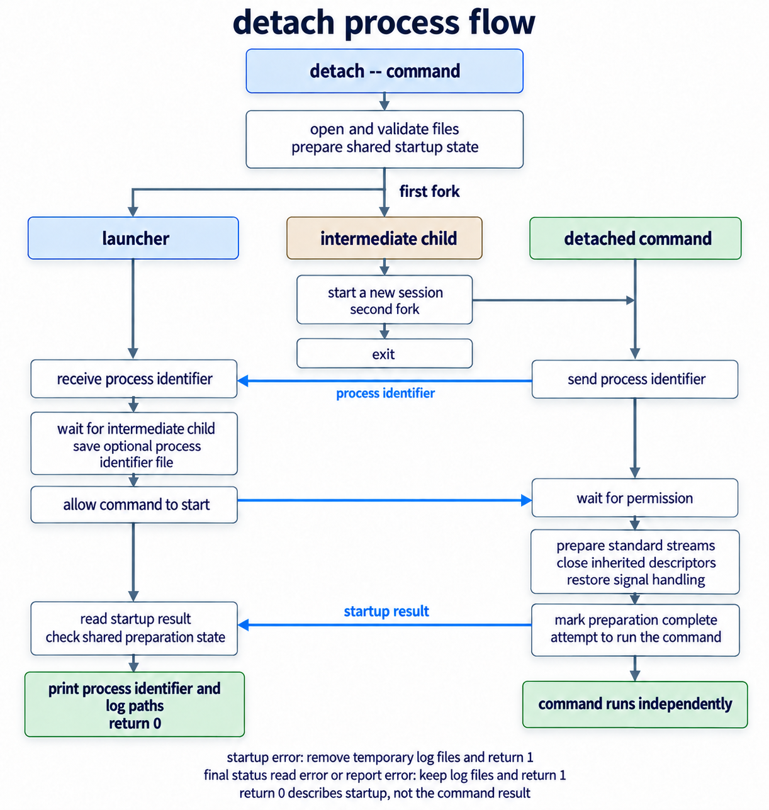

# detach-process


Spawn a new process and detach it from the current interactive session.


## Motivation

Detaching a long-running command usually means juggling `nohup`, backgrounding, `disown`, and redirections. This tool simplifies that workflow into one predictable command and reports the PID and output paths for easy scripting.

## Installation

Requirements: Linux or macOS with [git](https://git-scm.com/downloads), a C99 compiler such as [gcc](https://gcc.gnu.org/install), and `install`. For the one-line installer you also need [curl](https://curl.se/download.html) and `sudo`.

To install this package as a standalone application with the command-line interface you are to run the following command:

```bash
sudo sh -c "$(curl https://raw.githubusercontent.com/vladpunko/detach-process/master/install.sh)"
```

The install script defaults to `/usr/local/bin` for the binary and `/usr/local/share/man/man1` for the man page.

You can also install this system package on your working machine (works for unix-like operating systems) from source code to a system location:

```bash
# Step -- 1.
git clone --depth=1 --branch=master https://github.com/vladpunko/detach-process.git

# Step -- 2.
cd ./detach-process/

# Step -- 3.
gcc -std=c99 -Wall -Wextra -Werror -Wno-unused-parameter detach.c -o detach

# Step -- 4.
sudo mkdir -p /usr/local/bin /usr/local/share/man/man1
sudo install -m 755 detach /usr/local/bin/detach
sudo install -m 644 detach.1 /usr/local/share/man/man1/detach.1
```

## Uninstall

If you installed to the default paths, remove the binary and the man page:

```bash
sudo rm -f /usr/local/bin/detach /usr/local/share/man/man1/detach.1
```

If you installed to a different location, remove those files instead.

## Basic usage

Using this program allows you to create a new detached process avoiding complex shell pipelines in the current interactive session. It protects you from the trouble of closing an application which is the parent process of a different program.

```bash
detach ping -c 10 google.com  # pgrep ping | xargs ps -p
```

The launcher prints the command's process ID and log paths, then returns control to your shell. For example:

```text
PID: 12345
stdout: /tmp/stdout.aB3xYz
stderr: /tmp/stderr.cD4wUv
```

Use `--` to separate detach's options from the command you want to run. This is required when options are used.

You can write the PID and the standard output and error to specific files:

```bash
detach --pid ping.pid --stdout ping.out --stderr ping.err -- ping -c 10 google.com

tail -f ping.out ping.err
```

Use the standard input from a file:

```bash
detach --stdin README.md --stdout cat.out -- cat
```

Show usage:

```bash
detach --help
```

## Options

```text
detach [OPTIONS] -- program [ARGS...]

  --stdin FILE   read the standard input from FILE
  --stdout FILE  write the standard output to FILE
  --stderr FILE  write the standard error to FILE
  --pid FILE     write the program's process ID to FILE
  --help         show this help message and exit
```

By default, standard input comes from `/dev/null`, and standard output and error go to separate temporary files in `/tmp`. Existing regular output and PID files are overwritten. Standard output and error can share one file.

## Behavior

- Exit status `0` means no startup error was reported. It does not describe the command's eventual result.
- The command keeps the working directory, environment, and file creation mask. Relative paths resolve from that directory.
- A regular input file must differ from both outputs, and the PID file must differ from all streams. These checks include hard links and symlinks.
- Logs remain after the command exits. Remove them when they are no longer needed.



## Contributing

Pull requests are welcome. Please open an issue first to discuss what should be changed.

Please make sure this system package works without errors.

```bash
# Step -- 1.
python3 -m venv .venv && source ./.venv/bin/activate && pip install cpplint pre-commit

# Step -- 2.
pre-commit install --config .githooks.yml

# Step -- 3.
cpplint detach.c tests/cases/*.cc tests/support/*.{c,cc,h}

# Step -- 4.
make coverage
```

## License

[MIT](https://choosealicense.com/licenses/mit)
