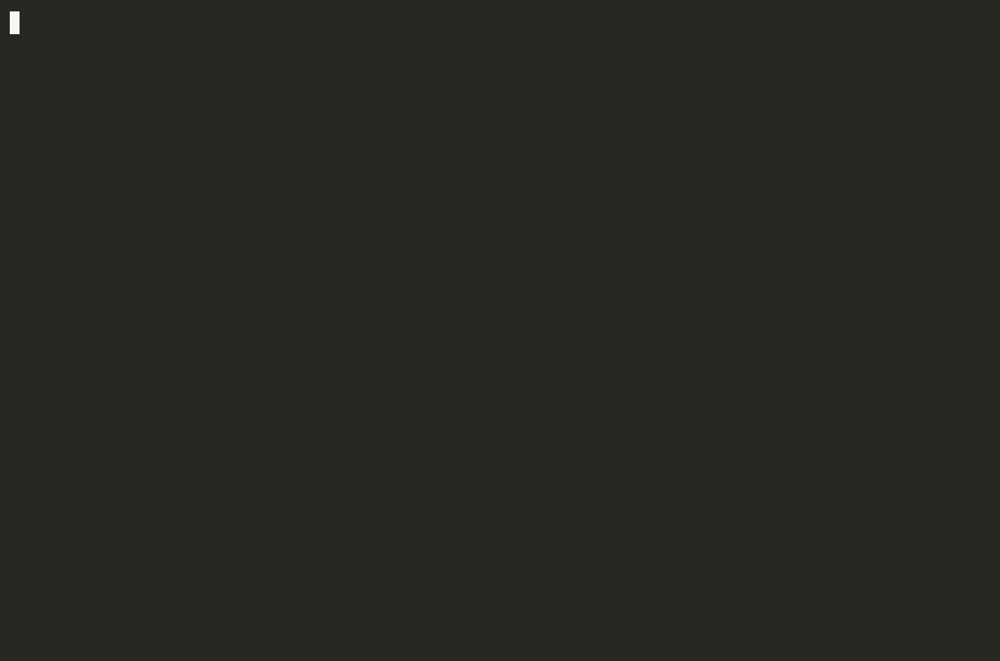

<div align="center">

# detach-process

**Run a command. Close the terminal. Keep it running.**

[](https://github.com/vladpunko/detach-process/actions/workflows/build.yml) [](LICENSE)

[Quick start](#quick-start) · [Installation](#installation) · [Usage](#usage) · [Behavior](#behavior) · [Development](#development)

</div>

`detach` starts a command in its own session, connects its standard streams to files, and returns control to your shell. The command can keep running after the terminal closes. Works on **Linux and macOS**.

Use it for a download, a script, or another job you want to leave running. It launches the job once; it does not monitor or restart it.

<p align="center">
  
</p>

## Quick start

Start a command after [installing detach](#installation):

```sh
detach -- sleep 3600
```

The launcher prints three lines and returns immediately:

```text
PID: 12345
stdout: /tmp/stdout.aB3xYz
stderr: /tmp/stderr.cD4wUv
```

The PID and generated paths vary. Follow the printed log paths with `tail -f`, or choose your own files:

```sh
detach --pid job.pid --stdout job.out --stderr job.err -- /bin/sh job.sh
tail -f job.out job.err
```

## Installation

Building requires a C99 compiler. The commands below also use Make and CMake 3.16+. At runtime, `/dev/fd` must be accessible; on Linux it usually points to `/proc/self/fd`.

```sh
git clone --depth=1 https://github.com/vladpunko/detach-process.git
cd detach-process
make build
./build/release/detach --help
```

Install the binary and manual page:

```sh
sudo mkdir -p /usr/local/bin /usr/local/share/man/man1
sudo install -m 755 build/release/detach /usr/local/bin/detach
sudo install -m 644 detach.1 /usr/local/share/man/man1/detach.1
```

<details>
<summary>Other installation methods and uninstall</summary>

**Compile directly.** The utility is a single C source file; this build needs neither Make nor CMake:

```sh
cc -std=c99 -Wall -Wextra -Werror -Wno-unused-parameter detach.c -o detach
./detach --help
```

Use `detach` as the source path in the binary installation command above.

**Use the installer.** From the cloned repository, run `sudo sh install.sh`. The [script](install.sh) downloads the `master` branch, compiles it with `gcc`, and installs the binary and manual page under `/usr/local`. It requires `git`, `gcc`, and `install`.

**Uninstall:**

```sh
sudo rm -f /usr/local/bin/detach /usr/local/share/man/man1/detach.1
```

</details>

## Usage

```text
detach [OPTIONS] -- program [ARGS...]
```

Use `--` to separate detach's options from the program's arguments. The separator is required when file options are used.

| Option | Meaning |
| --- | --- |
| `--stdin FILE` | Read input from `FILE` instead of `/dev/null`. |
| `--stdout FILE` | Write output to `FILE` instead of a unique file in `/tmp`. |
| `--stderr FILE` | Write errors to `FILE` instead of a unique file in `/tmp`. |
| `--pid FILE` | Save the command's PID before the command starts. |
| `--help` | Show help and exit. |

**Combine output and errors in one log:**

```sh
detach --stdout job.log --stderr job.log -- /bin/sh job.sh
```

**Read input from a file:**

```sh
detach --stdin input.txt --stdout output.txt -- sort
```

**Run a pipeline:**

```sh
detach -- /bin/sh -c 'printf "hello\n" | tr a-z A-Z'
```

Arguments go directly to the program. Pass an explicit shell for pipelines and other shell syntax. Executable scripts need a shebang such as `#!/bin/sh`, or an explicit interpreter as in the examples above.

## Behavior

- **Files:** existing regular output and PID files are truncated. There is no append mode. Logs remain after the command exits; remove them when finished.
- **File conflicts:** stdout and stderr may share a file. A regular input file must differ from both outputs. The PID file must differ from all streams. Checks include hard links and symlinks and run before truncation.
- **Caller state:** the command keeps the working directory, environment, and file creation mask. Relative paths resolve from that directory.
- **Exit status:** `0` means no startup error was reported; a nonzero status means an error occurred. This is the launcher's status, not the job's eventual result.

Startup diagnostics go to the terminal or the selected stderr file. A failure while printing the launch report can occur after the job has already started. An abrupt termination before `exec` can close the startup channel without reporting an error.

See `man detach` for the command reference and [How it works](docs/design.md) for session creation, file handling, and startup coordination.

## Development

```sh
make build
make test
make coverage
```

`make` defaults to `make build`. Tests need CMake 3.16+ and a C++20 compiler; coverage also needs Clang and matching LLVM tools. Test dependencies are separate from the standalone C utility.

See [Contributing](CONTRIBUTING.md) for focused test runs, the test layout, coverage reports, and style checks.

## License

[MIT](LICENSE) · Vladislav Punko
