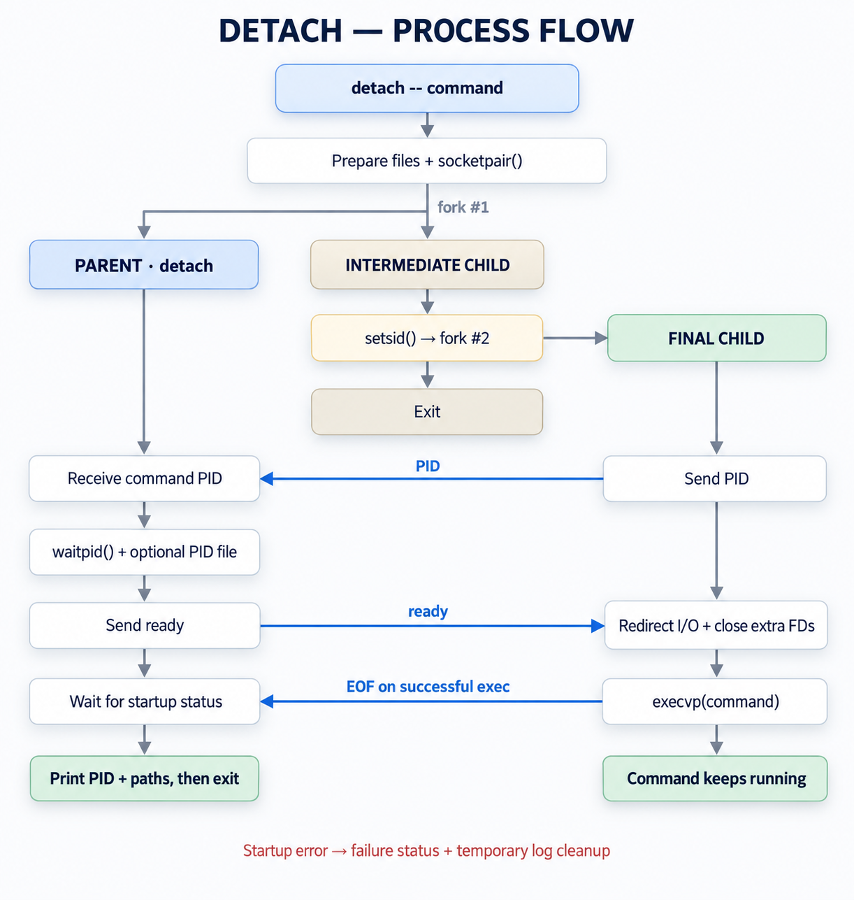

# How detach works

`detach` separates a command from the calling terminal and reports the launch. The command remains an ordinary process, with its own PID and file streams.

## Source layout

The utility stays in a single [C99 source file](../detach.c), so it can be built directly with a C compiler. Functions are grouped by responsibility:

- `parse_arguments()` collects file paths and the command in `struct options`.
- `open_launch_files()`, `validate_file_aliases()`, and `prepare_output_files()` open and check the files before changing their contents. `struct launch_files` keeps each path, descriptor, and file identity together.
- `launch_command()` creates the startup socket and forks. `run_launcher()`, `run_session_child()`, and `run_detached_command()` handle the three process roles separately.
- Startup messages, user-facing reports, and temporary-file cleanup have dedicated helpers. The failure paths distinguish a failed startup from a reporting error after the command may have started.

`main()` follows these stages in order. The temporary file names and saved signal dispositions stay alive until the launcher or child exits.

## Session and process lifecycle

1. Open the selected input, output, and optional PID files. Check file identities before truncating any existing regular files.
2. Fork an intermediate process and call `setsid()` there. This creates a session without the original controlling terminal.
3. Fork again. The final child belongs to the new session but is not its leader, so an ordinary terminal open cannot give it a controlling terminal.
4. Send the final child's PID to the launcher over a local socket. The launcher reaps the intermediate process and writes the PID file, if requested, before allowing the final child to proceed.
5. Redirect standard streams, close inherited descriptors, restore the caller's SIGPIPE disposition, and call `execvp()` to run the command.
6. Report the PID and output paths, then exit the launcher. The command keeps running independently.

The current working directory, environment, file creation mask, ignored signal dispositions, and blocked signal mask are preserved. Descriptors other than the redirected standard streams are closed by enumerating `/dev/fd`.

## File handling

Without explicit paths, stdin reads from `/dev/null`, while stdout and stderr use separate files created with `mkstemp()` as `/tmp/stdout.XXXXXX` and `/tmp/stderr.XXXXXX`.

New output and PID files are created with mode `0600`, subject to the caller's umask. Existing files retain their permissions. Regular output and PID files are truncated and rewound before use. Devices and pipes are not truncated.

The PID file must be distinct from all three streams. A regular input file must also be distinct from both outputs. Comparisons use the opened files' device and inode, so aliases through hard links and symlinks are detected before truncation. When stdout and stderr share a file, they share a file offset.

## Startup reporting

The final child reports setup and execution failures over the startup socket. The socket has close-on-exec set, so a successful `exec` normally closes it and lets the launcher print the three-line report shown in the [README](../README.md#quick-start).

An exit code of `0` means no startup error was reported. It says nothing about the command's later exit status. Socket closure can also mean that the child terminated abruptly before `exec` without reporting an error.

If printing the report fails, the launcher can return a nonzero status while the command is already running. It preserves the logs and attempts to print the PID and paths to stderr. Check those details before deciding to launch the job again.

The utility does not supervise the command, rotate its logs, restart it, or start it at boot. Those responsibilities belong to the caller or a service manager.

See [Contributing](../CONTRIBUTING.md#test-layout) for how the tests exercise the process lifecycle and startup failure paths.
